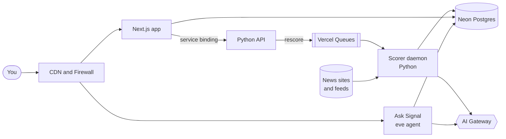

<p align="center">
  
</p>

<h1 align="center">Signal</h1>

<p align="center">
  <strong>The tech and AI news that matters to you, and why.</strong><br />
  Signal reads the sources you pick, scores every story against your interests,<br />
  and tells you in plain words why each one is worth your time.
</p>

<p align="center">
  <!-- TODO: replace YOUR-ORG/signal with the public repo once it exists -->
  <a href="https://vercel.com/new/clone?repository-url=https%3A%2F%2Fgithub.com%2FYOUR-ORG%2Fsignal&project-name=signal&repository-name=signal&env=PROFILE_EDIT_KEY&envDescription=Your%20owner%20key%3A%20any%20password%20of%2032%2B%20characters.%20You%27ll%20use%20it%20to%20sign%20in%20to%20your%20Signal.&stores=%5B%7B%22type%22%3A%22integration%22%2C%22integrationSlug%22%3A%22neon%22%2C%22productSlug%22%3A%22neon%22%2C%22protocol%22%3A%22storage%22%7D%5D"></a>
</p>

<p align="center">
  <sub>About 2 minutes. You bring a Vercel account; the database is created for you.</sub>
</p>

<br />

<!-- TODO: screenshot
<picture>
  <source media="(prefers-color-scheme: dark)" srcset="docs/feed-dark.png" />
  
</picture>
-->

## What it does

**🗞️ Reads the sources you pick.** Hacker News, The Verge, AI lab blogs, Vercel, Hugging Face and more, every 15 minutes. Turn any of them on or off.

**🎯 Scores every story against your interests.** Tell Signal what you care about in your own words. A small embedding model drops what's clearly off-topic, and an LLM reads the full article for the rest: a score out of 100, why it matters to you, and the takeaways.

**🔍 Shows you the parts worth reading.** Open a story and you get the opening, then the passages Signal flagged, each with a note in the margin. The rest stays at the source, one click away.

<!-- TODO: screenshot
<picture>
  <source media="(prefers-color-scheme: dark)" srcset="docs/story-dark.png" />
  
</picture>
-->

**💬 Lets you ask about any story.** Ask Signal waits in the corner of every page. It can read your feed, open any story, and look things up in Vercel's docs.

<!-- TODO: screenshot
<picture>
  <source media="(prefers-color-scheme: dark)" srcset="docs/ask-dark.png" />
  
</picture>
-->

## How it's built

One Vercel project, deployed from one `git push`: a Next.js app, a private Python API, an always-on Python worker, an AI agent and a Postgres database. Press **X-ray** in the app to see each part labeled on the real page.



| Part | What it does | Built with |
| --- | --- | --- |
| **Web app** | Renders the feed on the server, and checks for new scores every few seconds | [Next.js on Fluid Compute](https://vercel.com/docs/fluid-compute) |
| **Scorer** | Scans sources, reads each article, filters it with embeddings, and scores it | [Vercel Daemons](https://vercel.com/docs/daemons) |
| **Rescores** | When you change your interests, the web app asks the private API, which queues a rescore | [Services](https://vercel.com/docs/services/bindings) and [Vercel Queues](https://vercel.com/docs/queues) |
| **Ask Signal** | An agent whose instructions, tools and chat channel are files in `agent/` | [eve](https://eve.dev/docs) |
| **Models** | Claude Haiku scores stories, Claude Sonnet answers questions, both through one endpoint with no API keys | [AI Gateway](https://vercel.com/docs/ai-gateway) |
| **Database** | Stories, scores and your interests | [Neon, from the Marketplace](https://vercel.com/marketplace/neon) |
| **Features** | Turn parts of the app on or off without redeploying | [Vercel Flags](https://vercel.com/docs/flags) |

<!-- TODO: screenshot
<picture>
  <source media="(prefers-color-scheme: dark)" srcset="docs/xray-dark.png" />
  
</picture>
-->

## After you deploy

1. **Sign in** with the `PROFILE_EDIT_KEY` you chose.
2. **Open Your feed** and say what you care about, in a sentence or two, and pick your sources.
3. **Give it a few minutes.** The scorer picks up new stories every 15 minutes, and scores the recent ones as soon as you save.

### Private, or shared

Your Signal is **private by default**: every page and Ask Signal ask for your key. To share it, so anyone with the link can read your feed and chat, create a `public-access` flag and turn it on:

```bash
vercel flags create public-access --kind boolean --default-variant false --environment-variant production=true
```

Turn it off again in the Vercel dashboard, under **Flags**, with no redeploy. Your feed settings stay yours either way.

> [!TIP]
> Deploying to a team? Everyone shares one feed, tuned to whoever set it up. For a feed of your own, deploy to your own account.

<details>
<summary><strong>What it costs</strong></summary>
<br />

Signal runs on your Vercel account, and its AI calls are billed to your AI Gateway credits.

- **Scoring** runs around the clock. Only stories that pass the embedding filter go to the LLM, and it's Haiku, the smallest model.
- **Ask Signal** uses Sonnet, and each conversation stops at $0.50. When your Signal is shared, anyone with the link chats on your credits.

</details>

<details>
<summary><strong>How scoring works</strong></summary>
<br />

1. Every 15 minutes the scorer scans each source you turned on and saves new stories.
2. It reads each story's page and pulls out the article text.
3. A local embedding model ([bge-small](https://huggingface.co/BAAI/bge-small-en-v1.5)) compares the story to your interests and drops clear misses. These show as **No match**.
4. The rest go to Claude Haiku with the full article: a score, a one-line why, a short detail, two to four takeaways, and up to three passages worth reading.
5. Some sites don't let Signal read their pages. For those, Signal looks for another source covering the same news and works from that, and says so.

</details>

<details>
<summary><strong>What Signal shows from each article</strong></summary>
<br />

Signal reads the whole article to score it, but only shows the opening, the passages it flagged, and short quotes, always with a link to the source. Ask Signal can't quote the full text either.

</details>

<details>
<summary><strong>Run it locally</strong></summary>
<br />

You need Node.js 24, pnpm and Python 3.12, a Postgres connection string in `DATABASE_URL`, and the project linked with `vercel link` so AI Gateway can authenticate.

```bash
pnpm install && pnpm --dir web install
pnpm --dir web db:migrate   # create the tables
pnpm --dir web dev          # the web app, on localhost:3000
pnpm agent                  # Ask Signal
```

The scorer is written to run as a Vercel Daemon, which hands it a fresh AI Gateway token in a file. To run it locally, put the `VERCEL_OIDC_TOKEN` from `vercel env pull` in a file, then:

```bash
pip install -r scorer/requirements.txt
VERCEL_OIDC_TOKEN_FILE=path/to/token python scorer/worker.py
```

Tests:

```bash
python scorer/check_scoring.py
pnpm --dir web test
```

</details>

<br />

<p align="center">
  <sub>Built on <a href="https://vercel.com">Vercel</a>. See <a href="SECURITY.md">SECURITY.md</a> for how sign-in, spending limits and page reading are secured.</sub>
</p>
